# Milestone 2A — High-Fidelity UI Prototype

**Status:** Prototype visual untuk review — bukan implementasi dan belum ada persetujuan implementasi
**Branch:** `arena/02828d01-cybersecurity-assistant`
**HEAD acuan:** `88ad0e1e6745972e81198a8e2c1400746347b2c1`
**Tanggal:** 2026-11-23
**Dokumen dasar:** [`ui-ux-architecture-audit.md`](ui-ux-architecture-audit.md) · [`ui-ux-design-proposal.md`](ui-ux-design-proposal.md)

> Prototype ini dibuat sebagai wireframe visual high-fidelity statis dari vector artwork. PNG adalah render terverifikasi dari SVG yang disertakan; bukan screenshot emulator, bukan aplikasi berjalan, bukan Figma prototype, dan bukan representasi data aktual di perangkat. Tidak ada kode aplikasi yang diubah.

## 1. Keputusan desain yang diterapkan

Prototype ini mengikuti keputusan desain yang disampaikan untuk Milestone 2A:

1. Bottom Navigation tetap empat destinasi: **Home, Assessment, Reports, Settings**.
2. Assistant tetap tersedia di posisi tengah sebagai shortcut, dengan label **AI Preview**; tombol ini bukan destinasi kelima.
3. Digital Earth menjadi hero besar Dashboard, menggunakan globe wireframe 2D bercahaya. Keadaan idle tidak menampilkan node atau garis koneksi.
4. Security Score tampil **Unavailable** sampai metodologi disetujui; tidak ada angka atau persentase.
5. Risk Level keseluruhan tampil **Not calculated** sampai aturan agregasi disetujui. Findings severity counts tidak disamakan dengan risk level.
6. Scan Progress berdiri sendiri dan tampil **Idle** jika tidak ada Assessment berjalan.
7. Floating Edge Panel hanya ada di area aplikasi; closed/open/minimized dan sisi kiri/kanan diperlihatkan terpisah. Tidak ada permission overlay Android.
8. Terminal, Runtime Manager, AI Expert aktif, Knowledge Base dan Floating Workspace tidak tampil sebagai fitur aktif.

## 2. Batas preview dan asumsi perangkat

### Apa yang ditampilkan

- 15 layar/state ponsel statis: Dashboard utama dan lanjutan Analytics, Assessment, Reports, Findings, Activity, Settings, Connections, serta tujuh keadaan Edge Panel (closed kiri/kanan, open kiri/kanan, minimized, dan dua posisi vertikal).
- Data-listing di halaman Records menggunakan **empty state contoh**, bukan klaim bahwa database saat ini kosong. Pada penggunaan nyata, komponen tersebut harus menerima data lokal aktual dan beralih ke state populated/loading/error/partial yang sesuai.
- Status tool digambarkan sebagai “readiness resolved at run time”; tidak ada tool spesifik yang dinyatakan ready/unavailable.
- Target/endpoint pada contoh berupa petunjuk input kosong, bukan host atau endpoint nyata.

### Ukuran frame

Frame artwork memakai layar konten **390 × 860 logical px**, dibingkai sebagai handset ilustratif **430 × 900 px**. Ini ukuran prototype acuan untuk memeriksa hierarki dan density, **bukan ukuran yang diverifikasi pada model Redmi tertentu**. Pengguna belum menyebut model Redmi yang tepat, resolusi, density, atau ukuran font. Sebelum implementasi, prototype harus diuji ulang pada model yang disebutkan, termasuk cutout/safe area, mode navigasi sistem, dan skala font.

| Wilayah | Ukuran proposal | Catatan |
|---|---:|---|
| Status/system area | 24 dp | Ilustrasi status bar generik, bukan Android screenshot. |
| App bar | 54 dp | Judul layar dan badge LOCAL. |
| Content area | Scrollable, sekitar 708 dp sebelum Bottom Navigation | Konten Dashboard bertingkat; Analytics berada di bawah hero/instruments. |
| Bottom Navigation floating | Sekitar 370 × 72 dp, inset 10 dp | Empat tab tetap, Assistant shortcut tengah. |
| Page gutter | 14–16 dp | Gunakan scroll/wrapping; tidak mengandalkan fixed-width content. |
| Touch targets | Minimal 48 dp untuk kontrol final | PNG tidak membuktikan ukuran aksesibilitas; wajib diverifikasi di prototipe interaktif. |

> Ukuran pada render hanya menunjukkan layout yang diusulkan. Density pixel PNG tidak berarti ukuran physical device. Target yang disarankan untuk validasi adalah Redmi dengan lebar logical sekitar 360–393 dp, tetapi model aktual harus dikonfirmasi.

## 3. Visual system prototype

Prototype menggunakan palet dari proposal design system:

| Peran | Warna | Penggunaan |
|---|---|---|
| Canvas | `#0B1020` | Latar halaman. |
| Panel | `#151D31` | Kartu dan panel utama. |
| Raised panel | `#1B2740` | Segmented control, elemen bertingkat, state selected. |
| Muted inset | `#10182A` | Input, instrument dial, hero surface. |
| Primary text | `#F4F7FB` | Judul, status utama. |
| Secondary text | `#A9B6C9` | Bantuan, status sekunder, label. |
| Mint | `#73F0C2` | Aksi/selected state dan glyph instrumen; bukan klaim aman. |
| Electric blue / cyan | `#168DFF` / `#36D9FF` | Identity/glow Digital Earth dan status dekoratif. |
| Warning | `#F6C66B` | Label prototype/warning pada Connections. |
| Divider | `#2A3852` | Batas komponen dan gauge track. |

Tipografi sans-serif, angka contoh tidak ditampilkan untuk Score/Risk/Progress. Glow digunakan sebagai aksen terbatas. Tidak ada animasi aktual; file gambar hanya state statis.

## 4. Home Dashboard — hierarki visual

### First viewport

Urutan dari atas: header workspace → hero Digital Earth besar → tiga instrumen terpisah. Analytics dan recent records diletakkan setelahnya dalam scroll, bukan dipadatkan ke satu layar kecil.

- **Digital Earth hero:** kartu sekitar 362 × 315 dp pada viewport prototype; wireframe globe sekitar 188 dp diameter. Label `IDLE` dan `ILLUSTRATIVE · NO NODES OR CONNECTION DATA` membuat batas data terlihat.
- Globe memakai grid lintang/bujur dan rim glow sebagai ilustrasi, tidak ada titik, marker, garis koneksi, route, node, atau ancaman. Artwork tidak bergerak; rotasi lambat adalah konsep gerak masa depan yang baru boleh diimplementasikan setelah persetujuan.
- **Security Instruments:** tiga circular track terpisah, masing-masing dengan simbol/status non-numerik. Ring track kosong tidak mengisi persentase atau menunjukkan hasil.
- **Security Score:** `Unavailable` — `Methodology not defined`.
- **Risk Level:** `Not calculated` — severity count terpisah.
- **Scan Progress:** `Idle` — tidak ada assessment running.
- Bottom bar tetap menunjukkan empat tab serta shortcut tengah **AI Preview**.

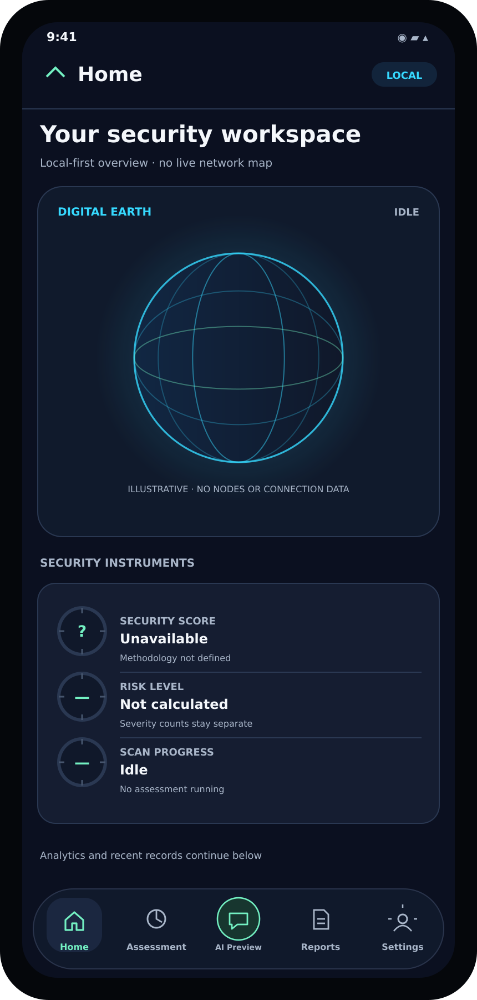

Sumber vector yang dapat diedit: [01-home-dashboard.svg](ui-ux-prototype-assets/01-home-dashboard.svg).

### Analytics — viewport lanjutan setelah scroll

Grafik/kartu Analytics ditampilkan pada layar scroll berikutnya untuk menjaga hero tidak terlalu kecil. Contoh seluruh panel di bawah menggunakan no-record state sebagai representasi visual; tidak ada klaim bahwa data database pengguna kosong.

- Findings by severity: kosong pada contoh; jika ada records, tampilkan count per severity dengan label scope.
- Assessment history: bersumber hanya dari Activity assessment events; empty state mengarahkan ke Assessment.
- Tool Registry status: dibangun dari resolver readiness aktual; jangan menyamakan jumlah entri registry dengan tools ready.
- Recent activity/reports tidak menunjukkan data live atau all-time tanpa sumber dan periode.

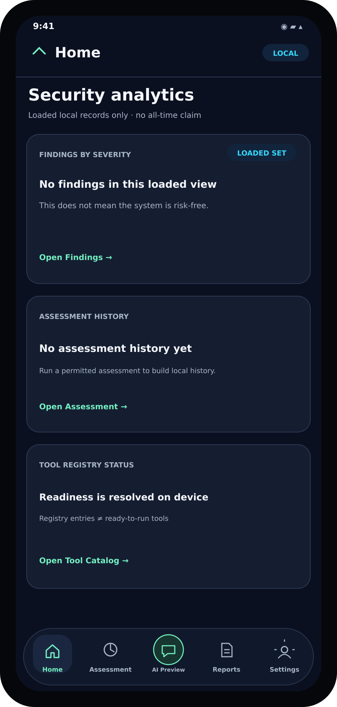

Sumber vector: [02-home-analytics.svg](ui-ux-prototype-assets/02-home-analytics.svg).

### Detail instrumen yang harus dipertahankan

| Instrument | Bentuk visual | Aturan konten |
|---|---|---|
| Security Score | Dial melingkar track kosong dengan `?`; label/status di samping | Jangan render score numerik, needle, fill, 0/100, atau nilai placeholder sebelum metodologi/data disetujui. |
| Risk Level | Dial melingkar track kosong dengan em dash; label/status terpisah | `Not calculated`; boleh menunjukkan Findings counts di analytics, bukan risk grade agregat. |
| Scan Progress | Dial track kosong dengan em dash ketika idle | Hanya tampilkan ring progress saat `AssessmentRunner` benar-benar aktif dan jumlah selected/outcomes tersedia. Tampilkan `completed / selected`, bukan progress tebakan. |

Jika metrik kelak tersedia, angka bisa ditampilkan besar di tengah gauge berdasarkan kontrak metrik yang disetujui. Sampai itu terjadi, ring netral dan status teks membuat komponen tetap berkarakter instrumen tanpa menyesatkan.

## 5. Assessment

### Susunan layar

1. Judul dan keterangan bounded checks.
2. Segmented control `Assessment` / `Tool Catalog`.
3. Field target kosong dengan hint `Enter authorized target`.
4. Explicit authorization checkbox, tidak tercentang secara default.
5. Tiga check dari Registry dengan status readiness yang ditentukan di runtime, bukan nilai hasil contoh.
6. Aksi review/start berada dalam disabled state sampai target sah, otorisasi, dan pilihan check yang ready terpenuhi.
7. Panel Radar menampilkan `IDLE` dan `Assessment not running`; tidak ada sweep/blips dalam state ini.
8. Setelah run nyata dimulai, panel dapat menunjukkan check aktif/outcome aktual; bukan bagian dari screenshot idle ini.

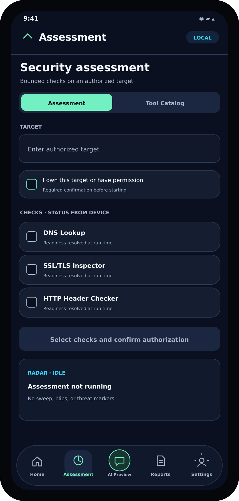

Sumber vector: [03-assessment.svg](ui-ux-prototype-assets/03-assessment.svg).

**Interaksi masa depan (belum diimplementasikan):** setelah validasi field/otorisasi, tampilkan ringkasan target dan checks; run sequential seperti perilaku yang dirancang saat ini; radar bergerak hanya pada state running. Cancel, failed, skipped, completed harus memiliki label berbeda. Jika reduced motion aktif, status tetap teks dan radar statis.

## 6. Reports, Findings, dan Activity

Ketiga layar tetap berada di destinasi **Reports** dan menggunakan segmented sub-navigation. Tab terpilih menggunakan label dan warna/indikator, bukan warna saja. Contoh pada gambar memperlihatkan no-data state untuk memeriksa komposisi; pada aplikasi, isi daftar mengikuti records aktual.

### Reports

- Segmen `Reports / Findings / Activity` mudah ditemukan.
- Pencarian/filter tersedia di area atas.
- Empty state membedakan session result dari report tersimpan lokal.
- Keterangan local storage; saved/session tidak disatukan seolah satu jenis record.
- List populated (bila ada) harus memakai tool, target yang disanitasi, waktu, summary dan status simpan aktual.

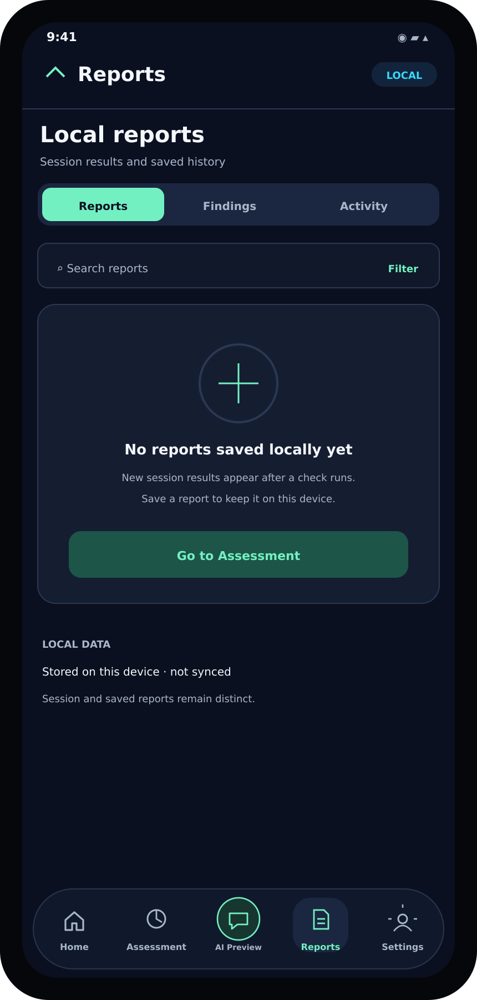

Sumber vector: [04-reports.svg](ui-ux-prototype-assets/04-reports.svg).

### Findings

- Search/filter severity/status/target mendahului daftar.
- Findings severity dan status adalah atribut records, bukan Risk Level keseluruhan.
- Empty copy tidak menyatakan “No threats” atau “secure”; data terbatas pada checks yang dilakukan/dimuat.
- Populated finding nantinya menampilkan confidence, first/last seen, source report/activity, evidence/recommendation, serta status dari record aktual.

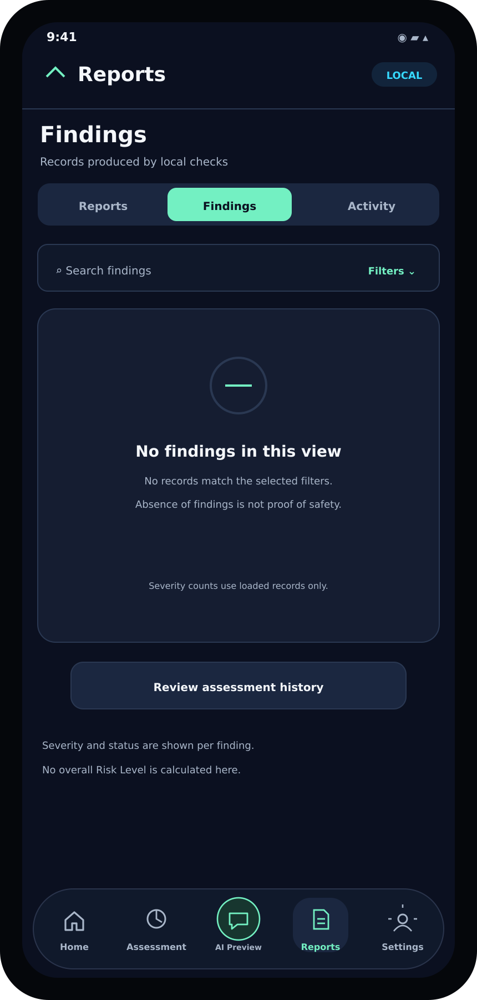

Sumber vector: [05-findings.svg](ui-ux-prototype-assets/05-findings.svg).

### Activity

- Filter Date range, Kind, Status; Tool filter dapat disediakan di view/filter drawer agar fit pada layar sempit.
- Event dibedakan assessment vs tool; timestamp/status/target aman dan sanitized.
- Tidak menjanjikan event sistem secara real-time atau semua aktivitas di luar app.
- Link source report tersedia hanya jika reference record ada.

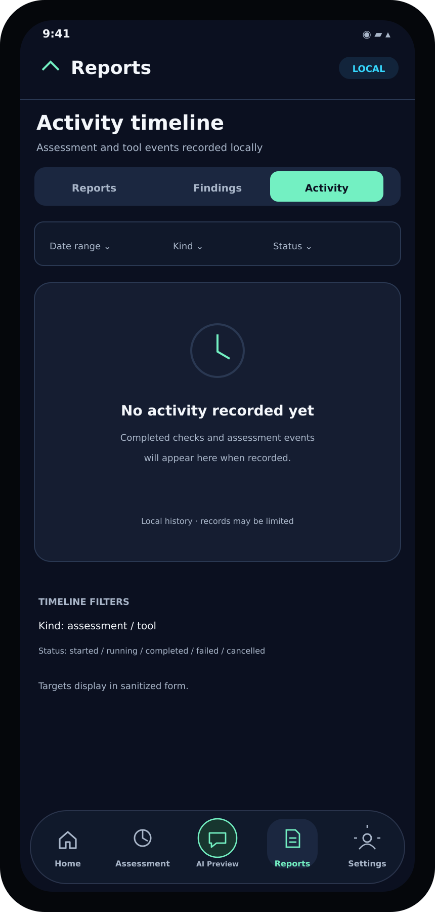

Sumber vector: [06-activity.svg](ui-ux-prototype-assets/06-activity.svg).

## 7. Settings dan Connections

### Settings

Daftar ringkas berbentuk row group: Language, Privacy & local data, Connections (prototype), Diagnostics, About. Privacy/local data memisahkan ekspektasi local-only dari AI/provider. Settings tetap tab primer, Connections halaman sekunder dengan back.

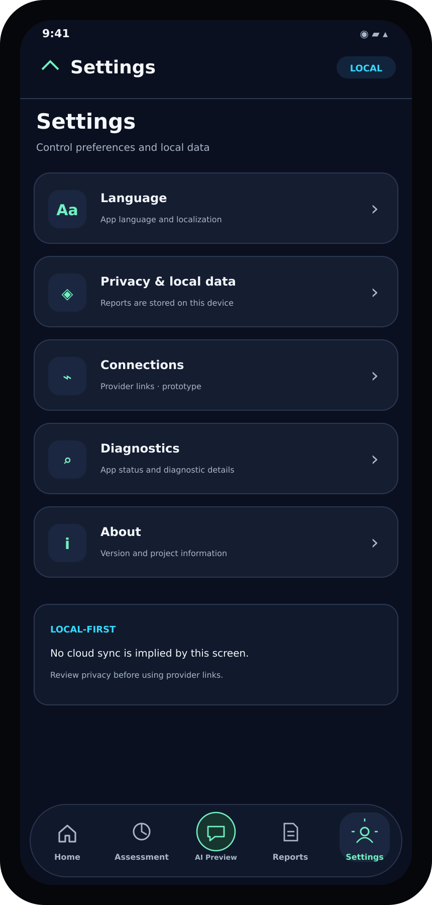

Sumber vector: [07-settings.svg](ui-ux-prototype-assets/07-settings.svg).

### Connections

- Badge `PROTOTYPE` mencegah kesan konektor provider aktif.
- Reachability test dipisahkan dari provider authentication/connection.
- Field menggunakan hint kosong; endpoint tidak diisi host nyata.
- Privacy disclosure muncul sebelum tes; endpoint reachable tidak mengaktifkan AI.

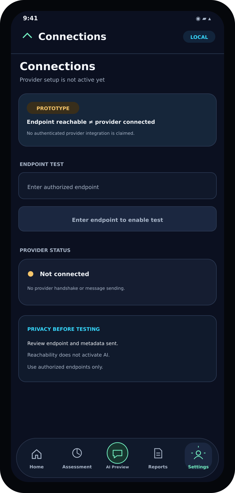

Sumber vector: [08-connections.svg](ui-ux-prototype-assets/08-connections.svg).

## 8. Floating Edge Panel

### Prinsip interaksi

Panel quick access berada di dalam `MainShell`, di atas konten app, tetapi tidak di atas aplikasi lain. Bottom Navigation tetap berada dan terlihat ketika panel terbuka. Tidak meminta `SYSTEM_ALERT_WINDOW`; panel tidak mengeksekusi tool dan hanya mengirim navigation intent ke halaman/segmen yang sama.

- Handle berada di edge kiri atau kanan; tap membukanya. Swipe handle menuju bagian dalam layar membuka panel.
- Drag vertikal memindahkan posisi handle; posisi snap tersimpan relatif pada tinggi area aman, bukan absolute pixel.
- Kontrol `Move to left/right` di panel memberi alternatif non-gesture untuk mengubah sisi.
- Panel open ditutup dengan close, swipe keluar, system back, atau memilih shortcut. Setelah shortcut dipilih, tab/sub-view aktual berubah dan panel menutup.
- Handle/panel dijaga agar tidak menutupi keyboard, target field, system gesture area, atau Bottom Navigation.
- State minimized kembali menjadi handle kecil; tidak menjalankan animasi looping.
- Daftar awal hanya fitur yang sudah tersedia/prototipe dan diberi status: Home, Assessment, Reports, Findings, Activity, Tool Catalog, Market, Connections, Settings, Assistant Preview. Item masa depan tidak ditampilkan sebagai aktif.

### Closed — handle di kanan

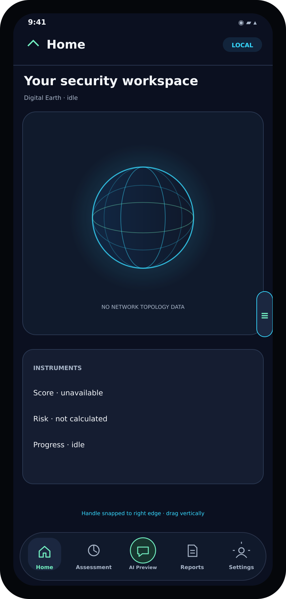

Source: [09-edge-closed-right.svg](ui-ux-prototype-assets/09-edge-closed-right.svg).

### Closed — handle di kiri

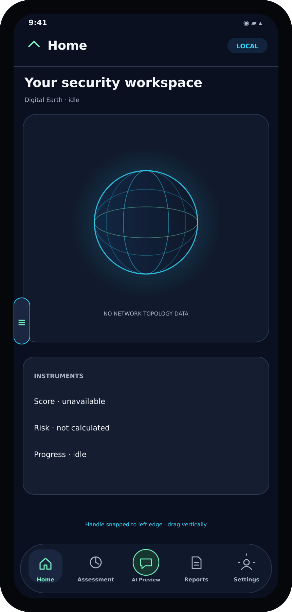

Source: [10-edge-closed-left.svg](ui-ux-prototype-assets/10-edge-closed-left.svg).

### Open — panel masuk dari kanan

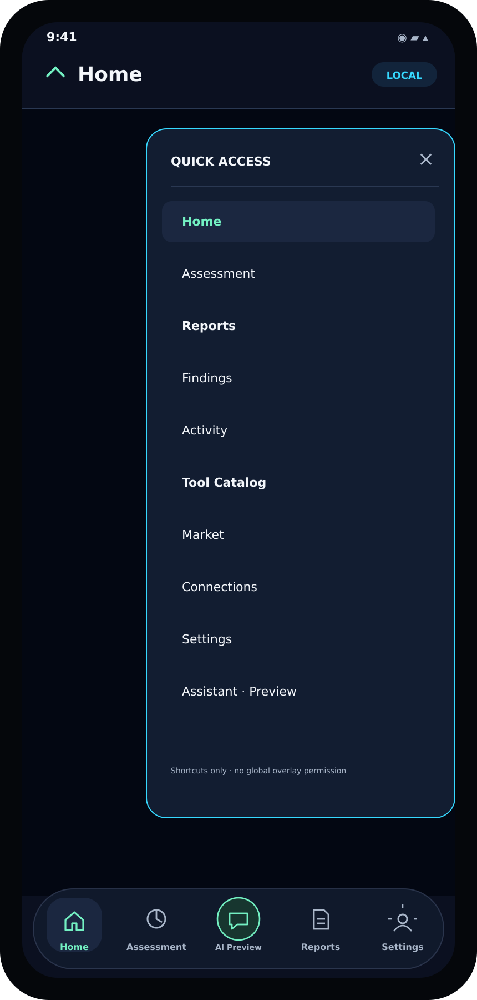

Source: [11-edge-open-right.svg](ui-ux-prototype-assets/11-edge-open-right.svg).

### Open — panel masuk dari kiri

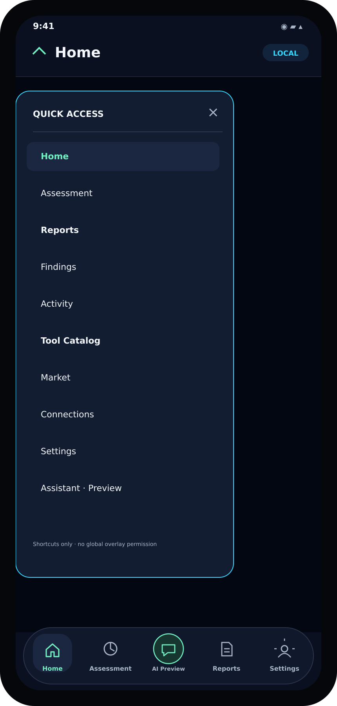

Source: [12-edge-open-left.svg](ui-ux-prototype-assets/12-edge-open-left.svg).

### Minimized

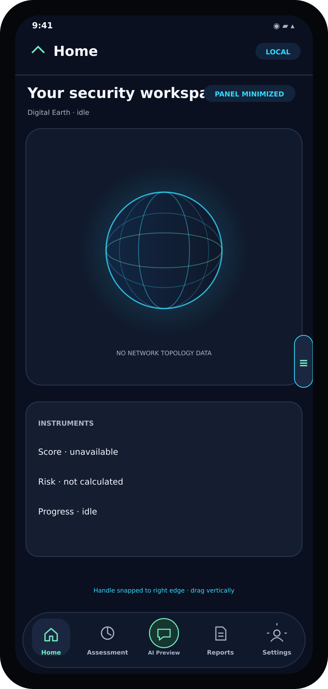

Source: [13-edge-minimized.svg](ui-ux-prototype-assets/13-edge-minimized.svg).

### Variasi posisi vertikal

Dua preview tambahan menunjukkan handle yang sama setelah dipindah ke posisi snap atas dan bawah. Posisi bawah tetap di atas floating bottom bar; posisi final perlu diuji terhadap safe area dan ukuran perangkat.

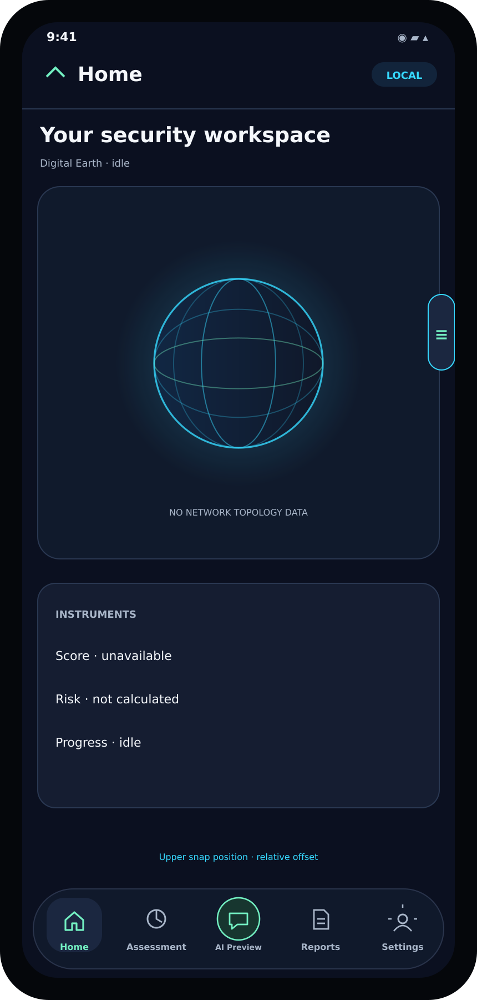

Source: [14-edge-position-upper-right.svg](ui-ux-prototype-assets/14-edge-position-upper-right.svg).

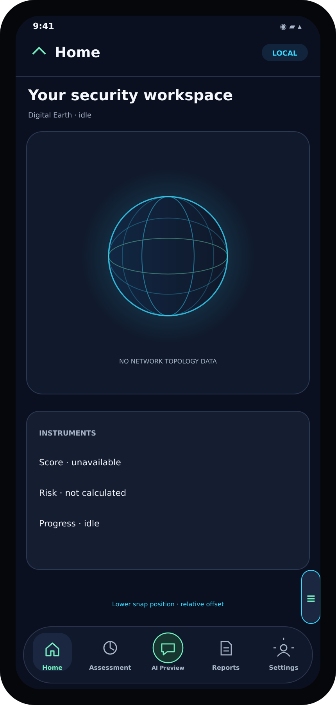

Source: [15-edge-position-lower-right.svg](ui-ux-prototype-assets/15-edge-position-lower-right.svg).

### Batas rancangan

| State | Perilaku visual | Perilaku yang masih harus diputuskan/diuji |
|---|---|---|
| Closed | Handle kecil, tidak berdenyut; posisi kiri/kanan ditunjukkan oleh preview berbeda | Target sentuh minimal 48 dp dan semantics; pastikan tidak menutupi content/action penting. |
| Open | Drawer in-app dengan scrim ringan dan daftar pintasan; nav bawah tetap tampak | Drawer width responsif, modal focus, back button, keyboard, screen reader dan tap-outside. |
| Minimized | Handle menjadi satu-satunya elemen panel | Apakah ukuran/sisi/offset terakhir tetap disimpan setelah app restart adalah keputusan preference yang perlu approval. |
| Dragging | Bukan animasi yang terus berjalan; handle mengikuti input lalu snap | Zona snap kiri/kanan dan atas/tengah/bawah perlu diuji dengan safe area, landscape dan mode satu tangan. |

## 9. State & copy untuk visual data

Prototype mengikuti prinsip “jangan tampil lebih maju dari mesin”. State teks berikut menjadi kontrak visual awal:

| Area | State idle/empty/unavailable | Saat data nyata tersedia |
|---|---|---|
| Digital Earth | `IDLE` / `No nodes or connection data` | Hanya tampilkan topology yang terukur/diizinkan beserta source, scope dan timestamp. |
| Security Score | `Unavailable` / `Methodology not defined` | Angka hanya setelah perhitungan dan cakupan disetujui; tampilkan penjelasan. |
| Risk Level | `Not calculated` | Kategori hanya setelah aturan aggregasi disetujui; severity counts tetap tampilan terpisah. |
| Scan Progress | `Idle` / `No assessment running` | Progress dari selected checks dan outcomes assessment aktif. |
| Radar | Statis / `Assessment not running` | Sweep hanya pada Assessment running; stop pada complete/fail/cancel. |
| Findings | `No findings in this view` | Hitungan severity records aktual; scope dan loaded record limit terlihat. |
| Assessment history | `No assessment history yet` | Aggregate dari Activity events dengan `kind=assessment` yang tersedia. |
| Tool Registry | Readiness belum/resolver sedang menentukan | Status per-tool aktual; registry count tidak sama dengan ready count. |
| Connections | `Prototype` / `Not connected` | Hanya ubah state jika authenticated provider flow nyata tersedia. |

## 10. Motion dan aksesibilitas (spesifikasi, tidak diimplementasikan)

- Preview PNG tidak menganimasikan globe, gauges, radar, atau Edge Panel.
- Rekomendasi motion: rotasi globe sangat lambat saat Dashboard visible; stop off-screen/background; tidak ada node/route saat idle.
- Radar hanya bergerak selama assessment aktif. Status progress tekstual tetap tersedia.
- Edge Panel bergerak singkat saat buka/tutup, tanpa auto-open/loop.
- Semua animasi harus menghormati reduced motion/`disableAnimations`; versi statis tetap menyampaikan status yang sama.
- Final prototype perlu cek kontras, TalkBack semantics, focus order, 48 dp touch target, text scaling dan lokalisasi Bahasa Indonesia/English. Artwork ini belum merupakan accessibility certification.

## 11. Artefak visual

Semua PNG di atas dirender dari vector sumber di `docs/ui-ux-prototype-assets/`. SVG menjadi sumber edit; PNG menjadi preview yang dibenamkan di dokumen. Render dipastikan membuka dan menampilkan komposisi melalui viewer. Ini **bukan** screenshot perangkat atau rekaman aplikasi yang berjalan. Gambar referensi eksternal dari prompt tidak diunduh; karya di sini adalah komposisi vektor baru untuk memvisualisasikan keputusan desain.

| ID | Isi | Preview | Vector |
|---|---|---|---|
| 01 | Home Dashboard: Digital Earth hero, 3 instrumen unavailable/idle | [PNG](ui-ux-prototype-assets/01-home-dashboard.png) | [SVG](ui-ux-prototype-assets/01-home-dashboard.svg) |
| 02 | Dashboard Analytics, viewport lanjutan dan empty state | [PNG](ui-ux-prototype-assets/02-home-analytics.png) | [SVG](ui-ux-prototype-assets/02-home-analytics.svg) |
| 03 | Assessment form & radar idle | [PNG](ui-ux-prototype-assets/03-assessment.png) | [SVG](ui-ux-prototype-assets/03-assessment.svg) |
| 04 | Reports empty state | [PNG](ui-ux-prototype-assets/04-reports.png) | [SVG](ui-ux-prototype-assets/04-reports.svg) |
| 05 | Findings empty state | [PNG](ui-ux-prototype-assets/05-findings.png) | [SVG](ui-ux-prototype-assets/05-findings.svg) |
| 06 | Activity empty state | [PNG](ui-ux-prototype-assets/06-activity.png) | [SVG](ui-ux-prototype-assets/06-activity.svg) |
| 07 | Settings | [PNG](ui-ux-prototype-assets/07-settings.png) | [SVG](ui-ux-prototype-assets/07-settings.svg) |
| 08 | Connections prototype/unconnected | [PNG](ui-ux-prototype-assets/08-connections.png) | [SVG](ui-ux-prototype-assets/08-connections.svg) |
| 09 | Edge handle closed, right | [PNG](ui-ux-prototype-assets/09-edge-closed-right.png) | [SVG](ui-ux-prototype-assets/09-edge-closed-right.svg) |
| 10 | Edge handle closed, left | [PNG](ui-ux-prototype-assets/10-edge-closed-left.png) | [SVG](ui-ux-prototype-assets/10-edge-closed-left.svg) |
| 11 | Edge panel open, right | [PNG](ui-ux-prototype-assets/11-edge-open-right.png) | [SVG](ui-ux-prototype-assets/11-edge-open-right.svg) |
| 12 | Edge panel open, left | [PNG](ui-ux-prototype-assets/12-edge-open-left.png) | [SVG](ui-ux-prototype-assets/12-edge-open-left.svg) |
| 13 | Edge panel minimized | [PNG](ui-ux-prototype-assets/13-edge-minimized.png) | [SVG](ui-ux-prototype-assets/13-edge-minimized.svg) |
| 14 | Edge handle snapped upper-right | [PNG](ui-ux-prototype-assets/14-edge-position-upper-right.png) | [SVG](ui-ux-prototype-assets/14-edge-position-upper-right.svg) |
| 15 | Edge handle snapped lower-right | [PNG](ui-ux-prototype-assets/15-edge-position-lower-right.png) | [SVG](ui-ux-prototype-assets/15-edge-position-lower-right.svg) |

## 12. Komponen Flutter reusable yang akan dibutuhkan (belum dibuat)

Komponen ini adalah pemetaan dari rancangan, bukan berkas/class yang ditambahkan:

- **Navigation:** `PrimaryBottomNavigation` (4 destination), `AssistantPreviewShortcut` (shortcut, bukan tab), `FloatingEdgeHandle`, `FloatingEdgePanel`, `QuickAccessItem`.
- **Shell/layout:** `AppBar`, `ResponsiveContentFrame`, `PageScaffold`, scrollable content dan safe-area policy.
- **Dashboard:** `DigitalEarthHero`, `InstrumentCard`, `CircularInstrumentTrack`, `SecurityScoreState`, `RiskLevelState`, `AssessmentProgressState`.
- **Assessment:** `TargetField`, `AuthorizationConfirmation`, `ToolReadinessRow`, `AssessmentRunControls`, `AssessmentRadarState`.
- **Records:** `ReportFilterBar`, `FindingFilterBar`, `FindingSeverityBadge`, `ActivityTimelineItem`, `LocalDataScopeCaption`.
- **Shared states:** `LoadingState`, `EmptyState`, `UnavailableState`, `ErrorState`, `PartialDataState`, `PrototypeStatusBadge`.

Komponen presentasional hanya menerima data/status aktual dan callbacks. Query/aggregation tetap memakai repository/sumber yang ada. Tidak perlu mengubah SQLite v4, Registry atau Orchestrator untuk membangun mockup ini.

## 13. Catatan risiko dan validasi Redmi

1. **Device belum spesifik:** minta model Redmi, resolusi, density, versi Android, dan preferensi font scale sebelum menyatakan layout terverifikasi. Preview saat ini memakai 390 dp logical reference.
2. **Dashboard fold:** hero dominan sengaja mengambil sebagian besar area atas; Analytics dan recent records harus berada setelahnya dalam scroll. Ukur apakah globe tetap cukup besar di 360 dp dan landscape.
3. **Nav lima aksi visual:** empat destination tab + Assistant shortcut memerlukan ruang label. Uji label terlokalisasi, ukuran layar kecil, font scaling besar, TalkBack, dan bentuk floating bar pada safe area.
4. **Gauges:** ring kosong tetap dapat keliru dipahami sebagai nilai 0. Pertahankan label `Unavailable/Not calculated/Idle`, tidak mengisi sweep, dan uji pemahaman dengan pengguna.
5. **Edge Panel:** drawer dapat menutup konten atau memicu gesture system. Perlu hit-testing, keyboard, drag vertical/horizontal, rotasi, snap point, close yang aksesibel, dan koordinasi dengan floating bottom bar.
6. **Performa:** Digital Earth pada gambar adalah 2D wireframe ringan. Hindari 3D/WebView/shader berat; animasi potensial harus berhenti off-screen/background dan mengikuti reduced motion.
7. **Data scope/privacy:** records saat ini lokal dan sejumlah view dibatasi hasil query. Tampilkan range, loaded count, timestamp dan sanitasi target; jangan membuat “all time” dari sampel.
8. **Preview statis:** PNG tidak menguji hit area, scrolling, state retention, motion, data binding, build performance, ataupun cold-start emulator.

### Checklist review pada perangkat

- [ ] Konfirmasi model Redmi dan ukuran logical viewport.
- [ ] Periksa Dashboard hero dominan tetapi tidak menghambat akses ke instrumen.
- [ ] Periksa gauge unavailable: menarik secara visual dan jelas bukan 0.
- [ ] Periksa Analytics berada di bawah fold dan tetap dapat ditemukan.
- [ ] Periksa empat tab utama dan tombol AI Preview di tengah, termasuk label lokal.
- [ ] Buka Edge Panel dari kiri dan kanan; pindahkan handle vertikal; pastikan Bottom Navigation tetap terlihat.
- [ ] Periksa Reports/Findings/Activity populated states dengan data lokal aktual dan empty states tanpa klaim “aman”.
- [ ] Periksa Settings → Connections agar endpoint test tidak terlihat sebagai provider connection.
- [ ] Periksa font scaling besar, TalkBack, landscape, reduced motion dan keyboard.

## 14. Tahap berikutnya

Prototype Milestone 2A ini diserahkan untuk review visual. Langkah yang masih menunggu keputusan:

1. Koreksi proporsi globe, ring gauge, density, label, warna, lokasi shortcut Assistant dan perilaku panel.
2. Sebutkan model Redmi target agar ukuran/spacing dapat disesuaikan dan diuji dengan tepat.
3. Bila desain visual disetujui, lakukan review/high-fidelity pass lanjutan untuk state populated/active menggunakan data sample yang secara eksplisit diberi label **illustrative**, atau data yang disetujui. Jangan menampilkan sample sebagai hasil aplikasi.
4. Minta persetujuan implementasi secara eksplisit dalam milestone terpisah. Dokumen ini **bukan** izin mengubah aplikasi.
5. Setelah izin implementasi terpisah, buat breakdown komponen dan tests; pertahankan Bottom Navigation, SQLite v4 dan pembatasan tanpa Runtime/Terminal.

## 15. Status pekerjaan dan batas

- Dibuat: dokumen prototype serta 13 pasangan aset SVG/PNG di `docs/ui-ux-prototype-assets/`.
- Dipertahankan: `docs/ui-ux-architecture-audit.md` dan `docs/ui-ux-design-proposal.md` tidak ditimpa atau dihapus.
- Tidak dilakukan: perubahan kode aplikasi, perubahan database/backend, dependency, Tool Registry, Orchestrator, animasi, Terminal/Runtime, commit, push, atau merge.
- **Status:** menunggu review pengguna. Tidak ada langkah implementasi otomatis sesudah dokumen ini.
